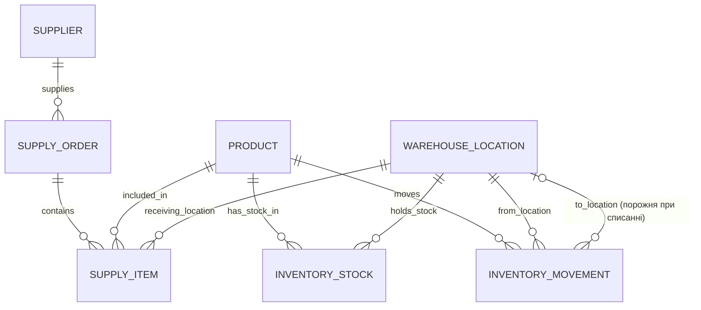

# Документація схеми бази даних WMS

## Діаграма сутність-зв'язок (ERD)

## Опис таблиць

### Таблиця: `supplier`
Призначення: постачальники товарів.

| Стовпець | Тип | Обмеження | Опис |
|----------|-----|-----------|------|
| supplier_id | INTEGER | PRIMARY KEY, IDENTITY | Ідентифікатор постачальника |
| company_name | VARCHAR(100) | NOT NULL | Назва компанії |
| contact_person | VARCHAR(100) | NOT NULL | Контактна особа |
| phone | VARCHAR(20) | NOT NULL, CHECK (LIKE '+%') | Телефон |
| email | VARCHAR(100) | NOT NULL, UNIQUE | Email |
| address | VARCHAR(255) | NOT NULL | Адреса |
| version | INTEGER | NOT NULL, DEFAULT 1 | Версія для оптимістичного блокування |
| deleted_at | TIMESTAMP | NULL | Мітка м'якого видалення (NULL = активний) |

Індекси: PK `supplier_pkey`, `idx_supplier_deleted_at`.  
Зв'язки: один-до-багатьох з `supply_order`.

### Таблиця: `product`
Призначення: каталог товарів.

| Стовпець | Тип | Обмеження | Опис |
|----------|-----|-----------|------|
| product_id | INTEGER | PRIMARY KEY, IDENTITY | Ідентифікатор товару |
| sku_code | VARCHAR(50) | NOT NULL, UNIQUE | Артикул |
| name | VARCHAR(100) | NOT NULL | Назва |
| description | TEXT | NULL | Опис |
| unit | unit_type (ENUM) | NOT NULL, DEFAULT 'piece' | Одиниця виміру |
| min_stock_level | INTEGER | NOT NULL, DEFAULT 0, CHECK (>=0) | Мінімальний залишок |

Індекси: PK `product_pkey`, UNIQUE `product_sku_code_key`.  
Зв'язки: один-до-багатьох з `supply_item`, `inventory_stock`, `inventory_movement`.

### Таблиця: `warehouse_location`
Призначення: комірки складу.

| Стовпець | Тип | Обмеження | Опис |
|----------|-----|-----------|------|
| location_id | INTEGER | PRIMARY KEY, IDENTITY | Ідентифікатор комірки |
| location_code | VARCHAR(50) | NOT NULL, UNIQUE | Код комірки |
| zone | VARCHAR(50) | NOT NULL | Зона |
| shelf_number | VARCHAR(50) | NOT NULL | Стелаж |
| max_capacity | INTEGER | NOT NULL, CHECK (>0) | Місткість |

Обмеження: `uk_zone_shelf UNIQUE (zone, shelf_number)`.  
Індекси: PK, UNIQUE `location_code`, UNIQUE `uk_zone_shelf`, `idx_inventory_stock_location`, `idx_inventory_movement_from`, `idx_inventory_movement_to`.  
Зв'язки: один-до-багатьох з `supply_item`, `inventory_stock`, `inventory_movement`.

### Таблиця: `supply_order`
Призначення: накладні постачання.

| Стовпець | Тип | Обмеження | Опис |
|----------|-----|-----------|------|
| order_id | INTEGER | PRIMARY KEY, IDENTITY | Ідентифікатор накладної |
| order_number | VARCHAR(50) | NOT NULL, UNIQUE | Номер накладної |
| supplier_id | INTEGER | NOT NULL, FK → supplier | Постачальник |
| supply_date | TIMESTAMP | NOT NULL, DEFAULT now() | Дата постачання |
| total_cost | NUMERIC(10,2) | NOT NULL, DEFAULT 0, CHECK (>=0) | Сума (денормалізований кеш) |
| status | order_status (ENUM) | NOT NULL, DEFAULT 'draft' | Статус |

Індекси: PK, `idx_supply_order_supplier`.  
Зв'язки: багато-до-одного з `supplier`; один-до-багатьох з `supply_item`.

### Таблиця: `supply_item`
Призначення: позиції накладної.

| Стовпець | Тип | Обмеження | Опис |
|----------|-----|-----------|------|
| order_id | INTEGER | NOT NULL, FK → supply_order | Накладна |
| product_id | INTEGER | NOT NULL, FK → product | Товар |
| location_id | INTEGER | NOT NULL, FK → warehouse_location | Комірка приймання |
| quantity | INTEGER | NOT NULL, CHECK (>0) | Кількість |
| unit_price | NUMERIC(10,2) | NOT NULL, CHECK (>=0) | Ціна за одиницю |
| batch_number | VARCHAR(50) | NOT NULL | Номер партії |
| expiry_date | DATE | NULL | Термін придатності |

PK: складений `(order_id, product_id)`.  
Індекси: `idx_supply_item_product`, `idx_supply_item_location`.

### Таблиця: `inventory_stock`
Призначення: поточні залишки по комірках.

| Стовпець | Тип | Обмеження | Опис |
|----------|-----|-----------|------|
| product_id | INTEGER | NOT NULL, FK → product | Товар |
| location_id | INTEGER | NOT NULL, FK → warehouse_location | Комірка |
| quantity | INTEGER | NOT NULL, CHECK (>=0) | Кількість |

PK: складений `(product_id, location_id)`.

### Таблиця: `inventory_movement`
Призначення: журнал переміщень і списань.

| Стовпець | Тип | Обмеження | Опис |
|----------|-----|-----------|------|
| movement_id | INTEGER | PRIMARY KEY, IDENTITY | Ідентифікатор руху |
| movement_type | movement_kind (ENUM) | NOT NULL | Тип (transfer/write_off) |
| product_id | INTEGER | NOT NULL, FK → product | Товар |
| from_location_id | INTEGER | NOT NULL, FK → warehouse_location | Звідки |
| to_location_id | INTEGER | NULL (FK) | Куди (NULL для списання) |
| quantity | INTEGER | NOT NULL, CHECK (>0) | Кількість |
| reason | VARCHAR(255) | NULL | Причина |
| movement_date | TIMESTAMP | NOT NULL, DEFAULT now() | Дата руху |
| created_by | VARCHAR(100) | NOT NULL | Автор |

Обмеження: `chk_different_locations`, `chk_movement_target`.  
Індекси: `idx_inventory_movement_product_date`, `idx_inventory_movement_from`.

## Рішення щодо дизайну

- **Нормалізація:** схема приведена до 3НФ. Виняток — `total_cost` у `supply_order` зберігається як денормалізований кеш суми позицій для швидкого читання; перераховується застосунком при додаванні/видаленні позицій. `inventory_stock` — матеріалізований оперативний стан залишків (інакше кожен запит залишків вимагав би агрегації всієї історії рухів).
- **Ключі:** сутності з власним ідентифікатором використовують `INTEGER GENERATED ALWAYS AS IDENTITY` (ADR 0001). Таблиці сполучення `supply_item` та `inventory_stock` мають складений PK з двох FK.
- **Тригери:** свідомо не використовуються (ADR 0002) — схема відповідає обсягу курсу (лекції 1–3). Цілісність стану (залишки, статуси, сума) забезпечується застосунком у транзакціях.
- **Індексування:** додано індекси на FK і поля, що часто використовуються у фільтрах/JOIN/сортуванні (supplier_id, product_id, location_id, movement_date). PK/UNIQUE створюють власні індекси автоматично.
- **Оптимістичне блокування:** колонка `version` у `supplier` для сценарію оновлення (ADR/лабораторна вимога).
- **Видалення:** жорстке видалення (hard delete) для товарів, комірок і накладних з обробкою FK-помилок; м'яке видалення (soft delete) для постачальників через колонку `deleted_at` (деактивація без втрати історії). Обидва підходи реалізовані.